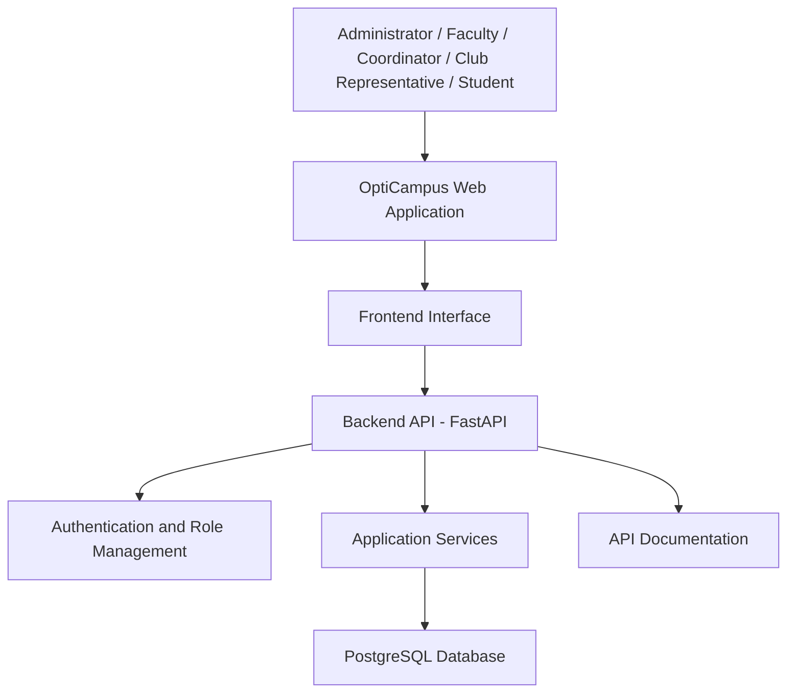

# OptiCampus | Smart Campus Scheduling & Venue Management Platform

**One Campus. Smarter Spaces. Seamless Scheduling.**

OptiCampus is a smart campus scheduling and venue management platform designed to simplify academic timetable coordination, room reservations, event planning, and institutional resource management. It provides a centralised system where administrators, faculty members, department coordinators, club representatives, and students can manage campus activities through a structured, role-based interface.

Instead of depending on spreadsheets, phone calls, and scattered WhatsApp conversations, OptiCampus brings campus scheduling and venue coordination into one accessible platform.

<p align="center">
  <a href="https://campusx-pink.vercel.app/">
    
  </a>
  <a href="https://github.com/Debangana-Dutta/OptiCampus">
    
  </a>
  <a href="https://campus-x-api-8o6d.onrender.com/docs">
    
  </a>
</p>

---

## Table of Contents

- [Project Overview](#-project-overview)
- [Problem Statement](#-problem-statement)
- [Our Solution](#-our-solution)
- [Key Features](#-key-features)
- [User Roles and Access](#-user-roles-and-access)
- [Demo Access](#-demo-access)
- [Admin Dashboard Workflow](#-admin-dashboard-workflow)
- [System Architecture](#-system-architecture)
- [Technology Stack](#-technology-stack)
- [Application Workflow](#-application-workflow)
- [Database and Backend](#-database-and-backend)
- [Project Structure](#-project-structure)
- [Getting Started](#-getting-started)
- [Environment Configuration](#-environment-configuration)
- [Deployment](#-deployment)
- [Security Considerations](#-security-considerations)
- [Testing and Verification](#-testing-and-verification)
- [Future Enhancements](#-future-enhancements)
- [Hackathon Context](#-hackathon-context)
- [Project Links](#-project-links)

---

## 🎯 Project Overview

OptiCampus addresses the everyday scheduling and venue coordination challenges faced by educational institutions.

In a typical campus environment, multiple departments, faculty members, student clubs, and administrative teams need access to shared spaces. Managing these requirements through disconnected spreadsheets and informal communication channels makes it difficult to maintain an accurate overview of campus resources.

OptiCampus provides a unified platform that supports:

- Centralised campus scheduling.
- Venue and room coordination.
- Structured access requests.
- Administrator-led account approval.
- Role-based access control.
- A consistent interface for different campus stakeholders.
- Better visibility into institutional scheduling activities.

The platform is designed around the needs of a college environment, with an emphasis on usability, clarity, accessibility, and efficient coordination.

## ⚠️ Problem Statement

Educational institutions frequently manage academic timetables, classrooms, laboratories, meeting spaces, and extracurricular events using separate spreadsheets, phone calls, and messaging applications.

This creates several challenges:

1. **Scheduling conflicts:** Multiple users may request the same venue for overlapping time slots.
2. **Fragmented communication:** Important booking information is distributed across different channels.
3. **Lack of centralisation:** Administrators may not have a single, reliable view of room availability and reservations.
4. **Manual approval processes:** Faculty and student representatives may need to contact administrators individually for access.
5. **Limited transparency:** Users may find it difficult to track the status of their requests.
6. **Administrative overhead:** Repeated manual coordination consumes time that could be used for other institutional activities.

These problems become particularly noticeable during examination periods, placement activities, college festivals, workshops, and other high-demand campus events.

## 💡 Our Solution

OptiCampus brings campus scheduling and venue management into a single web-based platform.

The system provides different experiences based on the user's assigned role. Users can access the functionality relevant to their responsibilities, while administrators retain control over account approvals and platform management.

The platform aims to make campus coordination more organised by replacing fragmented communication with a structured digital workflow.

### Core Objectives

- Reduce the possibility of scheduling and venue conflicts.
- Make campus resource coordination easier to understand.
- Simplify the process of requesting platform access.
- Provide administrators with a centralised management interface.
- Ensure that users access functionality according to their assigned roles.
- Build a foundation that can be extended for larger institutional requirements.

---

## ✨ Key Features

### 1. Centralised Campus Scheduling

A unified scheduling experience helps campus stakeholders coordinate academic and extracurricular activities.

- Organised scheduling information.
- Improved visibility into campus activities.
- A central location for scheduling-related operations.
- A foundation for reducing overlapping reservations.

### 2. Venue Management

OptiCampus is designed to support the coordination of shared institutional spaces.

- Centralised venue-related information.
- Structured venue booking workflows.
- Better visibility into resource allocation.
- Support for academic and extracurricular requirements.

### 3. Role-Based Access Control

Different campus stakeholders require different levels of access. OptiCampus uses role-based access to separate administrative and user-facing functionality.

- Administrator access for platform management.
- Faculty access for academic activities.
- Department coordinator access for departmental coordination.
- Club representative access for extracurricular activities.
- Student access for student-facing functionality.

### 4. Account Access Requests

New users can request access to the platform through a structured registration workflow.

- Users submit their account details.
- Requests are stored for administrator review.
- Pending requests can be reviewed through User Management.
- Administrators can approve or reject submitted requests.

### 5. Administrator Dashboard

The administrator dashboard provides a centralised management interface.

- Review account requests.
- Inspect submitted user details.
- Approve or reject eligible requests.
- Manage platform access.
- Monitor administrative workflows.

### 6. Modern User Experience

The interface is designed to make the platform approachable and easy to navigate.

- Clear navigation.
- Consistent visual components.
- Structured information presentation.
- Responsive web interface.
- Role-oriented user journeys.

---

## 👥 User Roles and Access

OptiCampus supports multiple user categories, each with a distinct purpose within the campus ecosystem.

| Role | Responsibility |
|---|---|
| Administrator | Manages the platform and reviews access requests. |
| Faculty | Uses the platform for faculty-related academic activities. |
| Department Coordinator | Supports departmental coordination and scheduling. |
| Club Representative | Coordinates club-related activities and venue requirements. |
| Student | Accesses student-facing platform functionality. |

Access is organised around the user's assigned role. Administrative functionality is reserved for authorised administrator accounts.

---

## 🔐 Demo Access

The following demo account is provided for evaluating the administrator workflow.

| Field | Demo credentials |
|---|---|
| Role | Administrator |
| Email / Username | `admin@opticampus.demo` |
| Password | `campusx-demo` |

### Admin Dashboard Workflow

After signing in, evaluators can:

1. Access the administrator dashboard.
2. Navigate to **User Management**.
3. Review pending faculty and department coordinator access requests.
4. Inspect submitted account details.
5. Approve or reject requests.
6. Verify role-based access after approval.

**Important:** Demo credentials are intended only for controlled evaluation. Do not reuse demo credentials for production or real institutional data.

---

## 🏗️ System Architecture

OptiCampus follows a frontend-backend architecture.

The frontend communicates with a backend API, which handles application logic, authentication-related operations, and database interactions.



### Architecture Components

| Component | Purpose |
|---|---|
| Frontend | Provides the user interface and communicates with the API. |
| Backend API | Handles application requests and business logic. |
| Authentication and role management | Supports account authentication and role-based access workflows. |
| Application services | Organise the platform's core operations. |
| PostgreSQL | Stores application data. |
| API documentation | Provides an interface for exploring available API endpoints. |

---

## 🛠️ Technology Stack

The application uses a modern web development stack.

| Layer | Technology | Purpose |
|---|---|---|
| Frontend | React | Component-based user interface |
| Build Tool | Vite | Frontend development and production builds |
| Backend | Python | Backend application logic |
| API Framework | FastAPI | REST API development |
| Database | PostgreSQL | Persistent application data |
| ORM | SQLAlchemy | Database interaction |
| Database Migrations | Alembic | Database schema migration management |
| API Documentation | OpenAPI / Swagger UI | API exploration and testing |
| Frontend Hosting | Vercel | Frontend deployment |
| Backend Hosting | Render | Backend deployment and hosting |
| Version Control | Git and GitHub | Source code management |

---

## 🔄 Application Workflow

### 1. User Access

A user opens the OptiCampus application and accesses the available login or access-request functionality.

### 2. Authentication

The user signs in using the appropriate account credentials.

### 3. Role-Based Navigation

The application provides access according to the user's assigned role.

### 4. Administrative Review

When a new faculty member or department coordinator requests access, the request can be reviewed by an administrator through User Management.

### 5. Approval or Rejection

The administrator reviews the submitted details and makes an approval decision.

### 6. Access Verification

Following approval, the account's assigned role determines the functionality available to the user.

---

## 🗄️ Database and Backend

The backend is built using FastAPI and PostgreSQL.

### Backend Responsibilities

- Handle frontend API requests.
- Process account access requests.
- Support authentication-related operations.
- Manage role-based account information.
- Communicate with the PostgreSQL database.
- Expose API documentation through Swagger UI.

### Database

PostgreSQL is used as the persistent data store.

SQLAlchemy provides the application's database interaction layer, while Alembic supports database schema migrations.

### API Documentation

The deployed backend provides interactive API documentation:

**[Open OptiCampus API Documentation](https://campus-x-api-8o6d.onrender.com/docs)**

The documentation can be used to explore available endpoints and inspect their request and response formats.

---

## 📁 Project Structure

The following is a representative overview of how the application is organised. Refer to the repository for the exact current file and folder structure.

```text
OptiCampus/
│
├── frontend/
│   ├── public/
│   ├── src/
│   │   ├── components/
│   │   ├── pages/
│   │   ├── assets/
│   │   ├── services/
│   │   └── ...
│   ├── package.json
│   └── ...
│
├── backend/
│   ├── app/
│   │   ├── api/
│   │   ├── models/
│   │   ├── schemas/
│   │   ├── services/
│   │   └── ...
│   ├── alembic/
│   ├── requirements.txt
│   └── ...
│
└── README.md
```

---

## 🚀 Getting Started

Follow these steps to run the project locally.

### Prerequisites

Make sure the following tools are installed:

- Git
- Node.js and npm
- Python
- PostgreSQL

### 1. Clone the Repository

```bash
git clone https://github.com/Debangana-Dutta/OptiCampus.git
cd OptiCampus
```

### 2. Set Up the Frontend

Navigate to the frontend directory:

```bash
cd frontend
```

Install dependencies:

```bash
npm install
```

Configure the frontend environment variables as described in the Environment Configuration section.

Start the development server:

```bash
npm run dev
```

### 3. Set Up the Backend

Open another terminal and navigate to the backend directory:

```bash
cd backend
```

Create a virtual environment:

```bash
python -m venv venv
```

Activate it on Windows:

```powershell
.\venv\Scripts\Activate.ps1
```

Activate it on macOS or Linux:

```bash
source venv/bin/activate
```

Install the backend dependencies:

```bash
pip install -r requirements.txt
```

Configure the backend environment variables and database connection.

Start the backend using the project's configured ASGI application entry point. For example, if the application entry point is `app.main:app`:

```bash
uvicorn app.main:app --reload
```

The exact commands and directory names should be checked against the current repository configuration.

---

## ⚙️ Environment Configuration

The application uses environment variables to separate configuration from source code.

### Frontend

Example:

```env
VITE_API_BASE_URL=http://localhost:8000
```

For the deployed frontend, the API base URL is configured as:

```env
VITE_API_BASE_URL=https://campus-x-api-8o6d.onrender.com
```

The frontend application appends its API path internally, so the base URL should not include an additional `/api` suffix.

### Backend

The backend requires environment-specific configuration for database connectivity, authentication, CORS, and optional demo account seeding.

Typical configuration categories include:

```env
DATABASE_URL=your_database_connection_string
CORS_ORIGINS=your_frontend_origin
FRONTEND_URL=your_frontend_url
LOCAL_AUTH_SECRET=your_unique_secret
```

If demo account seeding is enabled in a controlled evaluation environment, configure the required demo-seeding variables according to the backend implementation.

**Never commit real database credentials, authentication secrets, private keys, or production passwords to GitHub.**

---

## ☁️ Deployment

OptiCampus is deployed using Vercel, Render, and PostgreSQL.

| Service | Deployment |
|---|---|
| Frontend | [OptiCampus Live Application](https://campusx-pink.vercel.app/) |
| Backend | [OptiCampus API](https://campus-x-api-8o6d.onrender.com) |
| API Documentation | [Swagger UI](https://campus-x-api-8o6d.onrender.com/docs) |
| Database | PostgreSQL hosted through Render |

### Frontend Deployment

The frontend is hosted on Vercel.

The deployment uses the configured API base URL to communicate with the backend service.

### Backend Deployment

The backend is hosted on Render.

The service handles API requests and connects to the configured PostgreSQL database.

### Database Deployment

PostgreSQL provides persistent storage for the application.

Environment-specific database configuration is maintained through the hosting provider rather than committed to the source repository.

---

## 🔒 Security Considerations

OptiCampus includes role-oriented access workflows and administrator-controlled account approval.

Important considerations for real institutional deployment include:

- Use unique and strong authentication secrets.
- Do not expose administrator passwords in public repositories.
- Keep database credentials in protected environment variables.
- Restrict administrative functionality to authorised users.
- Configure trusted frontend origins for cross-origin requests.
- Replace demo authentication settings with institution-ready authentication before production use.
- Use secure password handling and appropriate session management.
- Apply suitable access controls to institutional data.

The demo environment is intended for evaluation and demonstration. It should not be treated as a production-ready deployment for confidential institutional information without additional security review.

---

## 🧪 Testing and Verification

The application can be evaluated through the deployed frontend and backend API documentation.

Suggested evaluation checklist:

- [ ] Open the live OptiCampus application.
- [ ] Verify that the frontend loads successfully.
- [ ] Sign in using the administrator demo account.
- [ ] Open the administrator dashboard.
- [ ] Navigate to User Management.
- [ ] Review pending faculty access requests.
- [ ] Review pending department coordinator access requests.
- [ ] Approve or reject a request.
- [ ] Verify the resulting account access and role-based navigation.
- [ ] Open the Swagger API documentation.
- [ ] Inspect the available API endpoints.

---

## 🔮 Future Enhancements

OptiCampus provides a foundation that can be extended with additional campus management capabilities.

### Intelligent Scheduling

- Automated timetable generation.
- Conflict detection for overlapping reservations.
- Availability-based venue recommendations.
- Scheduling optimisation based on institutional constraints.

### Enhanced Venue Management

- Interactive campus venue directory.
- Room capacity and equipment information.
- Real-time booking status.
- Calendar-based venue availability.

### Notifications and Communication

- Automated booking confirmations.
- Approval and rejection notifications.
- Scheduling reminders.
- Updates for modified or cancelled reservations.

### Analytics and Reporting

- Venue utilisation reports.
- Department-wise scheduling insights.
- Booking activity summaries.
- Administrative dashboards with usage analytics.

### Institutional Integration

- Integration with existing academic timetables.
- Institutional single sign-on.
- Calendar integrations.
- Support for larger multi-department campus environments.

These enhancements represent possible future development directions and are not claims of currently implemented functionality.

---

## 🏆 Hackathon Context

**Event:** Tech Zephyr  
**Institution:** IIT Bhubaneswar  
**Track:** Web Development  
**Problem Category:** Campus Scheduling and Venue Management

OptiCampus was developed as a solution to the challenges of campus scheduling, shared venue coordination, and administrative access management.

The project focuses on building a practical and accessible platform that can help educational institutions organise their campus operations more efficiently.

---

## 📌 Project Links

| Resource | Link |
|---|---|
| Live Application | [OptiCampus](https://campusx-pink.vercel.app/) |
| GitHub Repository | [OptiCampus Repository](https://github.com/Debangana-Dutta/OptiCampus) |
| Backend API | [OptiCampus API](https://campus-x-api-8o6d.onrender.com) |
| API Documentation | [Swagger UI](https://campus-x-api-8o6d.onrender.com/docs) |

---

<p align="center">
  <strong>OptiCampus</strong><br/>
  One Campus. Smarter Spaces. Seamless Scheduling.
</p>
